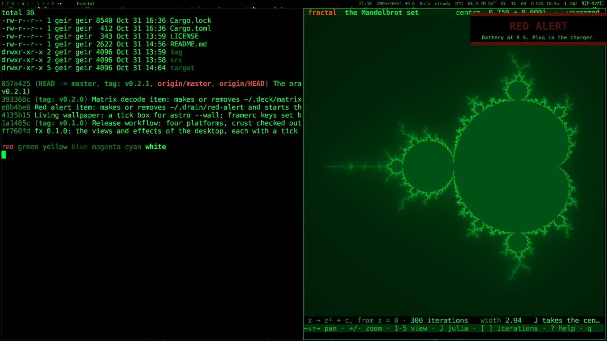

After the Star Trek [face lift](/2026/10/Face-Lift.html), I got the urge to have a Matrix-inspired workspace.

One tick in fx, and I'm in the Matrix. Sort of.



The voice is mine. So is the music: Longing III.1, from [Rise Above](/2026/10/Rise-Above.html). The mail, calendar and task data is made up. So is Claude's answer.

## Green code on black

- **The desktop**: the bar, the window borders, the launcher and the notifications go green on black. Katakana on the bar and down the side of the launcher. The wallpaper is a picture of the green rain.
- **Every app**: [glass](https://github.com/isene/glass), my terminal, keeps the brightness of each colour and makes it green. Pictures too. The Mandelbrot set in [fractal](https://github.com/isene/fractal) comes out green.
- **Red stays red**: a strong red is left alone. The red alert is still red. The red pill.
- **Beam-in**: a new window falls in as code. [frame](https://github.com/isene/frame), my X server, draws it in 0.6 seconds.
- **gluon and deck**: `Ctrl+Shift+B` steps through plain, the bridge and the Matrix.
- **Matrix decode**: Claude's answers in [deck](https://github.com/isene/deck) arrive as green glyphs that settle into text. It came with the face lift. Now it has a desktop to match.

## Views

LCARS and Matrix are views. A view is one file with the colours for each program. [fx](https://github.com/isene/fx) shows a tick box for each, and one is on at a time.

With the view off, glass skips the green. With it on, glass works out the green for its 255 colours once, when it starts. A colour an app gives, or a picture, gets its green as it arrives. Nothing runs on a timer.

## The film

Same as last time. Claude ran a hidden copy of my desktop and typed the keys as I said the words. It filmed each scene and cut it to my voice. The music changes just as gluon turns green.

## Summary

- [fx](https://github.com/isene/fx): the pop-up with the views and effects
- [frame](https://github.com/isene/frame): the X server, where windows fall in as code
- [glass](https://github.com/isene/glass): the terminal that turns every app green
- [gluon](https://github.com/isene/gluon): mail, calendar, tasks and Claude
- [deck](https://github.com/isene/deck): my Claude Code interface
- [launch](https://github.com/isene/launch): the app launcher
- [herald](https://github.com/isene/herald): the notifications
- [fractal](https://github.com/isene/fractal): the Mandelbrot set in real pixels
- [CHasm](https://isene.org/chasm/): the desktop in assembly
- [Fe₂O₃](https://isene.org/fe2o3/): the apps in Rust
- [The film on YouTube](https://youtu.be/CkQxbgfi3pk)

---

Link to this post: https://isene.org/2026/10/Matrix.html
