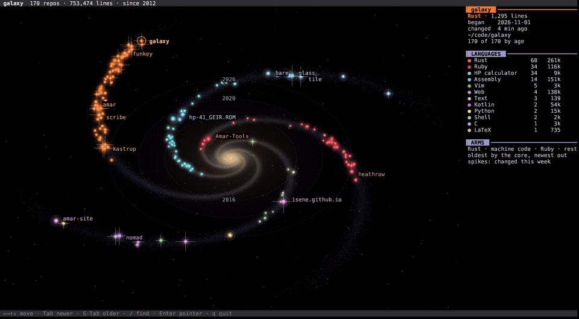
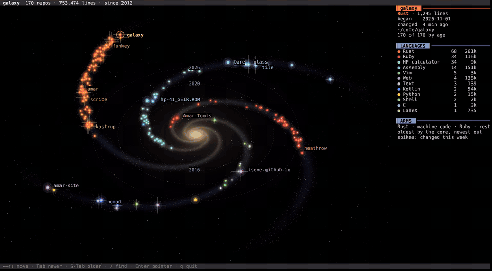

Three new things on my desktop today. A galaxy of my repos, an overview of my workspaces and a warp core for the battery.

## Galaxy

Every repo is a star. Its size comes from its lines of code, its colour from its language. Rust has one arm, assembly another, Ruby a third. The oldest repos sit by the core, the newest out at the tips.

A repo changed this week has spikes. A commit makes its star flare. Enter opens the repo in [pointer](https://github.com/isene/pointer), my file manager.

While I look at it, it sleeps. A key or a commit wakes it.

Try it in the browser, with my 170 public repos: [galaxy on the try page](https://isene.org/fe2o3/try/app.html?a=galaxy). A click on a repo's address opens it on GitHub.

## The overview

`Mod4+space` shows all ten workspaces at once, with a live picture of every window. The arrows move around, Enter jumps to the selected workspace while a digit jumps straight to one.

[frame](https://github.com/isene/frame) (my X server) draws it. It does work only when open. You know, my battery OCD.

## The warp core

`w` in [drain](https://github.com/isene/drain), my battery app, shows the watts as a warp core beside a chart of the day. The bands run faster as the draw climbs. Blue at low draw, amber by 8 W, red by 11 W. It's now usually around 3W.

## The films

Claude ran a hidden copy of my desktop, typed the keys and filmed. The galaxy has my public repos only.

## Summary

- [galaxy](https://github.com/isene/galaxy): my repos as a spiral galaxy
- [galaxy in the browser](https://isene.org/fe2o3/try/app.html?a=galaxy): with my public repos
- [frame](https://github.com/isene/frame): the X server, with the overview
- [drain](https://github.com/isene/drain): the battery app, with the warp core
- [CHasm](https://isene.org/chasm/): the desktop in assembly
- [Fe₂O₃](https://isene.org/fe2o3/): the apps in Rust

---

Link to this post: https://isene.org/2026/11/Galaxy.html
