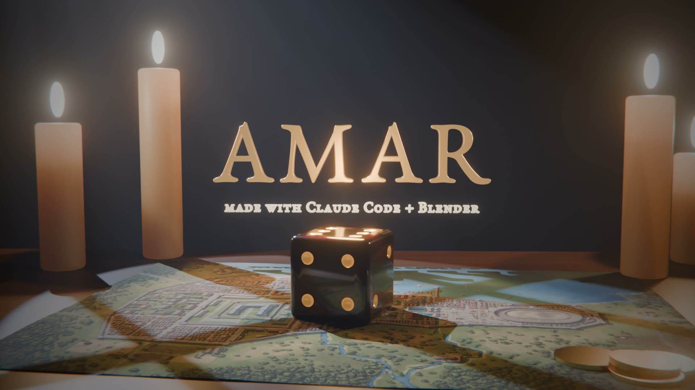

I used to do a lot of work in Vistapro, Terragen and Bryce back in the days. I also dabbled in Blender. Now I wondered if I could do more than dabble, given that there is a Blender MCP that I could use with Claude Code.

So I asked Claude for something amazing. Something to show what the two can do together.

<video src="/assets/posts/amar-o6.mp4" controls playsinline></video>

A die drops onto the map of Amaron. Slow motion as it hits. Sparks fly. It lands on a six... and AMAR appears in gold.

## How it was made

No Blender window. No mouse. Claude wrote Python, and Blender ran it in the background.

Everything you see is code: the table, the candles, the die, the sparks, the title. Claude worked out the fall and every bounce.

The slow start is real slow motion. At the slowest, Blender draws four pictures for every normal frame.

Claude made the thuds too, from the same numbers as the bounces. Each one lands on its frame.

The music is mine: Amaron Wakes from the album Amar.

## Summary

- [Blender](https://www.blender.org): free 3D software
- [Claude Code](https://claude.com/claude-code): wrote every line
- [The Kingdom of Amar](https://d6gaming.org): my role-playing world

---

Link to this post: https://isene.org/2026/11/Blender.html
