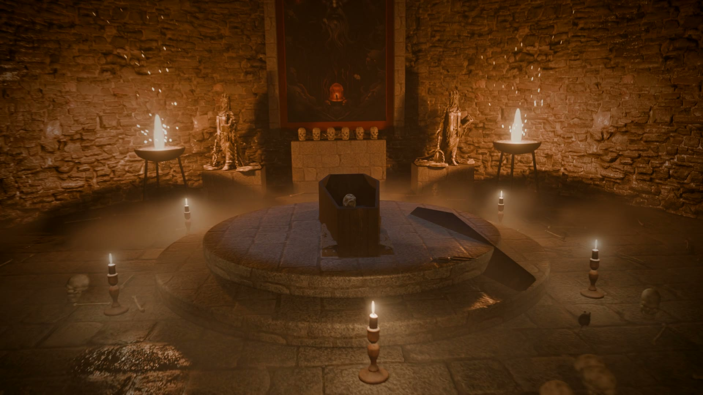

Yesterday a [die rolled a six in Blender](/2026/11/Blender.html). Today I went deeper.

Before heading into town, I gave Claude one task: take me into a dungeon. Scary, but not so dark you can't see. Torches, skulls, bones on the floor, frescos on the walls, an open coffin. A touch of Mestronorpha. Take three hours to render if you need to.

<video src="/assets/posts/amar-crypt.mp4" controls playsinline></video>

Down the stairs and along a corridor lined with skulls. Torches flicker. A rat darts across the floor. At the end, a crypt: an open coffin, a skeleton, candles... and Mestronorpha on the wall. His eyes piercing.

Mestronorpha is the Master of the Underworld in Amar, the wielder of darkness.

## How it was made

Same as last time: no Blender window, no mouse. Claude wrote Python, and Blender ran it in the background.

Every skull is code. Balls and tubes melted into one piece, holes cut for the eyes and nose, the teeth set one by one. The first skulls looked like cartoons. Two rounds later they looked like bone.

The stone, the floor and the wood come from Poly Haven, free for anyone to use. The frescos are pictures from the Amar website.

A thousand frames. About two hours of rendering on the laptop while I was in town.

The music is mine.

## Summary

- [Blender](https://www.blender.org): free 3D software
- [Claude Code](https://claude.com/claude-code): wrote every line
- [Poly Haven](https://polyhaven.com): free textures
- [The Kingdom of Amar](https://d6gaming.org): my role-playing world

---

Link to this post: https://isene.org/2026/11/Crypt.html
