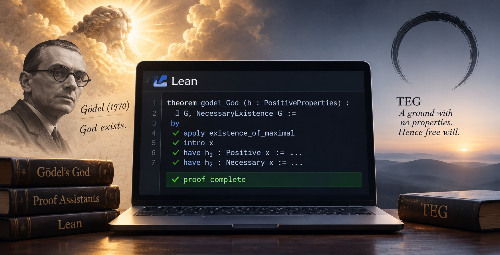

A proof assistant is a program that checks a proof, step by step. You state the premises. You write the steps. It accepts each step or refuses it. You can't bullshit your way through.

The best known today is [Lean](https://lean-lang.org). Mathematicians use it to check their proofs.

It can't tell you if your premises are true. It only checks that the conclusion follows. You have to defend the premises yourself.

## Gödel's God

In 1970 Kurt Gödel wrote a short proof that God exists. A few axioms about "positive properties"... and out comes a being that has them all, and necessarily exists.

In 2013 Christoph Benzmüller and Bruno Woltzenlogel Paleo fed it to the machines. What was found then and later:

- Gödel's own version contradicts itself. A machine found it in 2016, almost fifty years after he wrote it.
- Dana Scott's repaired version has no contradiction. But it proves a lot more: if God exists by necessity, then every true fact is necessary. Nothing could have been otherwise. No room for free will.
- In September Benzmüller moved it all to Lean. It confirmed the results. It also caught two assumptions the older proofs had slipped in unseen. Lean is rather awesome.

## TEG in Lean

I ran the core of [TEG](https://isene.com/freewill) through Lean too. First it found a few premises I had left unsaid. I thought them implicit, but then I wrote them into the papers. Now it passes.

TEG ends at the opposite of Gödel's God: a ground with no properties at all. It forces nothing. Hence free will.

The three papers are coming soon to a PhilPapers near you.

## Summary

- [Lean](https://lean-lang.org): the proof assistant
- [Gödel's proof in Lean](https://arxiv.org/abs/2609.26806): Benzmüller, 2026
- [The first machine check](https://ebooks.iospress.nl/pdf/doi/10.3233/978-1-61499-419-0-93): Benzmüller and Woltzenlogel Paleo, 2014
- [Claude Code](https://claude.com/claude-code): wrote the Lean files
- [TEG](https://isene.com/freewill): my work on Free Will

---

Link to this post: https://isene.org/2026/11/Proof-by-machine.html
