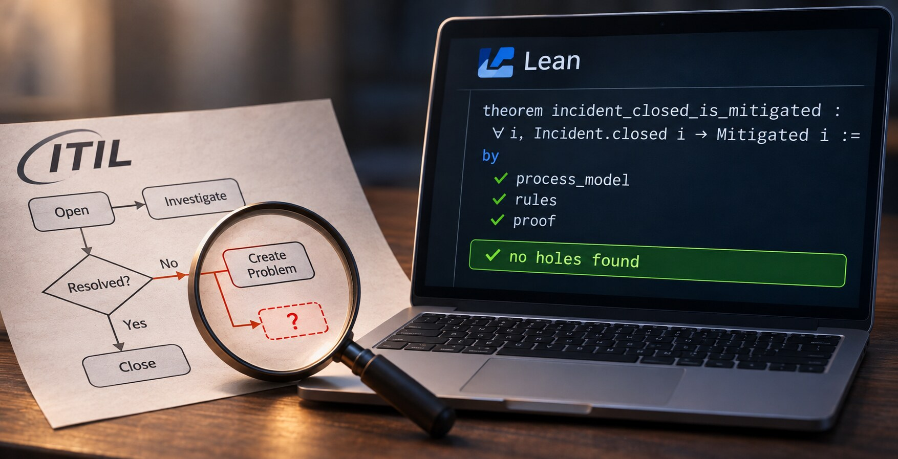

I used to work extensively with the IT Infrastructure Library framework (ITIL) from 2004 to 2018.

In [my last post](https://isene.org/2026/11/Proof-by-machine.html) I let [Lean](https://lean-lang.org) check Gödel's God and my own work on free will. That got me wondering... Can it check a business process?

A process is tickets, moves and rules. An Incident is open or closed. A Change is submitted, approved or rejected. Lean can prove that a rule is true in every state the process describes. With any number of tickets. I was onto something similar back in 2009 when I looked into [Petri Nets](https://isene.org/2026/07/The-Selection-Gap.html) for simulating business processes. Lean takes this a long step further.

## The test

My own [ITIL guide](https://isene.org/assets/files/itil.pdf). Incident, Problem, Change and Release, written as [HyperLists](https://isene.org/hyperlist/).

HyperList is my own creation from 2007 and onward; a way to describe any state or transition in pure text.

I asked Claude to write it as a Lean model. Every step in the text became a move. Then we ran it through Lean.

## What Lean found

Some rules passed. A Release can only ship an approved Change. Good.

Then four holes:

- **Nobody decides a Change with Impact 3.** The policy says "Impact < 3" and "Impact > 3". The value of 3 falls in between.
- **An Incident can close while the user is still down.** "No solution found" jumps to "Create Problem ticket", past the step that checks if the user is still in a struggle.
- **A Problem can close before its Change is released.** The process moves on when the Change is approved. It never waits for the Release. Bad move.
- **A Problem can live forever.** If every Change for it is rejected, it never closes. There is no "won't fix". In real life there often is.

Four holes in fourteen pages. They sat there for years. I never saw them.

## The fix

Four small edits. One of them is a single character: `>` became `>=`.

Lean then proved that the holes are gone. Every closed Incident is mitigated. Every closed Problem has its Change released, or was closed as "won't fix" after a rejection.

## The limit

Lean checks the process on paper. It can't check that people follow it.

But a process with holes on paper has holes in real life. People fill them with guesses. Or some creative moves.

## Summary

- [Lean](https://lean-lang.org): the proof assistant
- [ITIL pragmatic and simple](https://isene.org/assets/files/itil.pdf): the guide, with the four fixes
- [Itil.lean](https://isene.org/assets/files/Itil.lean): the model and the proofs
- [HyperList](https://isene.org/hyperlist/): how the processes are written
- [petri](https://github.com/isene/petri): my Petri net player for the terminal
- [Claude Code](https://claude.com/claude-code): wrote the Lean file
- [Proof by machine](https://isene.org/2026/11/Proof-by-machine.html): the post before this one

---

Link to this post: https://isene.org/2026/11/Proving-a-process.html
