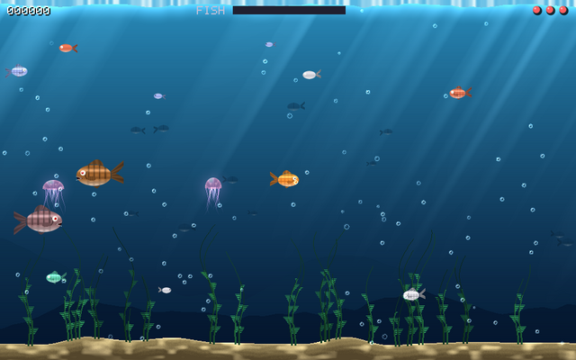

Been a gamer on-and-off since the early 80s. Actually programmed my first game on a TI-57 calculator back in 1978. Always fun to see what can be done with simple concepts...

You are a dot. You eat dots. That is the whole game of *bigger*.

And there are bigger dots. Always a bigger dot.

## Play it

Right here:

<canvas id="bigger-game" data-wasm="/assets/play/bigger.wasm?v=1.1" aria-label="bigger, a dot that eats dots and grows"></canvas>

<button type="button" id="bigger-full">Full screen</button> <button type="button" id="bigger-keys">Keys on screen</button>

Click the game, then `Space`. On a phone the keys show under it.

- The arrows steer.
- Eat the small. Avoid the big ones.
- `P` pauses. `Q` quits.

That is all you need to know. The rest the game tells you when you get there.

## Seven sizes

The dot was a cell in a drop of pond water. The cell was inside a fish. The fish lived on a moon and so on.

Every size plays its own way:

- A moon falls round a giant. Mind the gravity.
- Stars pull at each other. Everything pulls everything.
- Get too big and you blow up. What is left is a neutron star, with a beam that breaks the big rocks into food.
- Too heavy, and you fall in on yourself. A black hole eats anything. Stop eating and you fade.

And then the picture pulls back some more.

## The same idea as universe

[universe](https://github.com/isene/universe) is one of my Fe₂O₃ apps: every scale in 37 steps, from the quantum foam to the cosmic web. You step out and you step in. [Try it in your browser](/2026/10/TryFe2O3.html).

bigger comes from the same idea. In *universe* you look at the scales. In bigger you eat your way up on that scale.

## The Game Room

**[The Game Room](https://isene.com/games/)** has fourteen games now. Pick one and play. A top ten under every game, comments under every game, no sign-up.

*bigger* joined the family: [play it full size](https://isene.com/games/play.html?g=bigger) and beat the top ten.

## Dust

The game I did yesterday is also in the room: [dust](https://isene.com/games/play.html?g=dust).

You dig down through caves where every pixel is a grain. Sand heaps. Water finds its level. Oil floats and burns. Acid eats rock. Lava sets the wood alight and turns to stone in water. Feels a bit like Terraria.

Four wands: bore, flame, spout and bomb. Take the gold. Mind the slimes, bats and imps. Find the gate to the next depth.

## Summary

Built with [Claude](https://claude.com/claude-code) on [funkey](https://isene.org/funkey/).

Public Domain, like [everything I make](/2026/04/MyTools.html).

- **[The Game Room](https://isene.com/games/)**
- [bigger in the Game Room](https://isene.com/games/play.html?g=bigger)
- [dust in the Game Room](https://isene.com/games/play.html?g=dust)
- [bigger on GitHub](https://github.com/isene/funkey/blob/master/examples/bigger.rs)
- [universe on GitHub](https://github.com/isene/universe)
- [All the games, in a terminal too](https://isene.org/funkey/)

---

Link to this post: https://isene.org/2026/11/Bigger.html
