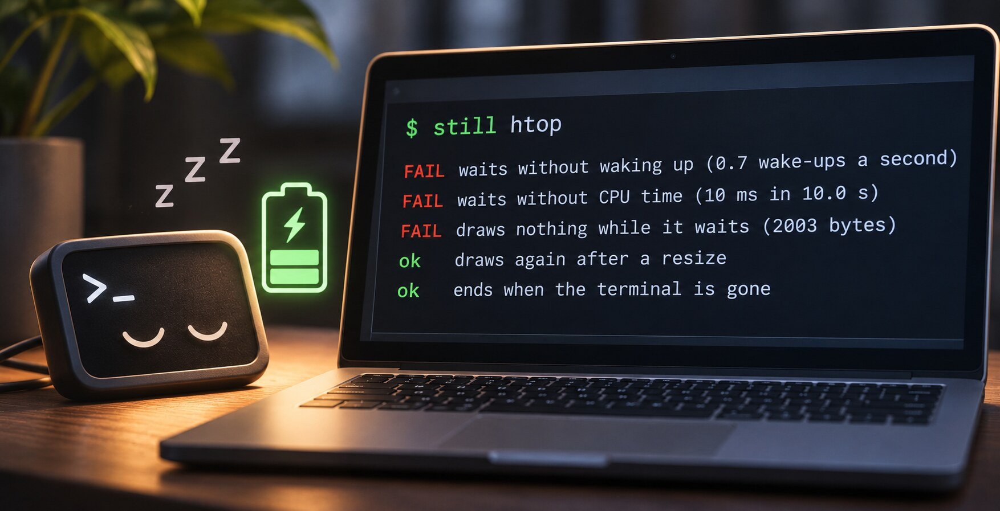

I'm admittedly pretty OCD about my setup.

A terminal program waits most of its life... for a key. It should do nothing while waiting. No timer, no peeking, no wake-up.

Many such programs do something anyway. And nobody sees it, because the program still works. Only the battery gets the hit.

## Finding out

One of my own programs was left running after its terminal window was closed. It used a full processor core until it was killed.

The cause was a known bug in a library that many Rust programs use, [crossterm](https://github.com/crossterm-rs/crossterm/issues/793). A dead terminal reads as "nothing yet", again and again, looping for ever.

Then I looked at my file manager. It woke up every two seconds to see if the folder had changed. 43,000 times a day. For no real reason. My old [RTFM](https://github.com/isene/RTFM) file manager had such a wake-up since 2020. And it transferred right onto [pointer](https://github.com/isene/pointer).

I had no tool that would have told me. So Claude and I made one.

## still

[still](https://github.com/isene/still) runs a program in a terminal of its own and watches it wait:

```
$ still htop
FAIL waits without waking up (0.7 wake-ups a second)
FAIL waits without CPU time (10 ms in 10.0 s)
FAIL draws nothing while it waits (2003 bytes)
ok   draws again after a resize
ok   ends when the terminal is gone
```

It counts how many times the program wakes up, how much processor time it takes, and what it draws. Then it takes the terminal away and checks that the program ends.

It is also a Rust library, so the check can be a test:

```rust
let mut app = still::Run::new("target/release/myapp").start().unwrap();
app.settle(Duration::from_millis(500));
let idle = app.idle(Duration::from_secs(1)).unwrap();
assert_eq!(idle.wakeups, 0);
```

## The well-known ones

I ran it on programs most Linux users use. Debian 13, each program fresh from its package, no settings, ten seconds of waiting.

| Program | Wake-ups a second | Ends with its terminal |
|---|---|---|
| nano, neovim, helix, ne | 0 | yes |
| less, man, mc, nnn, ncdu, tig | 0 | yes |
| mutt, newsboat, w3m, screen, tmux | 0 | yes |
| vim | 0.1 | yes |
| micro | 0.4 | yes |
| ranger | 0.5 | yes |
| neomutt | 0.9 | yes |
| joe | 1.0 | yes |
| irssi | 1.8 | yes |
| kakoune | 1.9 | yes |
| weechat | 4.0 | yes |
| emacs | 4.3 | yes |
| aptitude | 6.1 | yes |
| fzf | 50 | yes |
| vifm | 69 | yes |
| lazygit | 0 | no, it sleeps on |
| calcurse | 1.0 | no, it takes a full core |
| tty-clock | 1.0 | no, it takes a full core |

A clock may tick once a second. A monitor like htop or top must wake up to do its job; they woke less than once a second.

But a file manager that wakes 69 times a second while I look at a folder? That is six million times a day.

And two programs do what mine did: close the window, and they take a full core until someone kills them.

## My own

I ran it on my own programs too. Most were quiet. Some were not:

- The file manager now asks the kernel to tell it when the folder changes. No timer.
- Three programs asked their own threads "done yet?" once a second, also when no thread was running. Now they ask only while one is indeed running.
- The password prompt took a full core on a dead terminal. Fixed.

## Summary

A program that waits should cost nothing. Now there is a test for this.

- [still](https://github.com/isene/still): the tool and the library
- [crossterm issue 793](https://github.com/crossterm-rs/crossterm/issues/793): the dead terminal bug
- [Fe₂O₃](https://isene.org/fe2o3/): my terminal programs
- [Claude Code](https://claude.com/claude-code): wrote the code with me

---

Link to this post: https://isene.org/2026/11/Still.html
