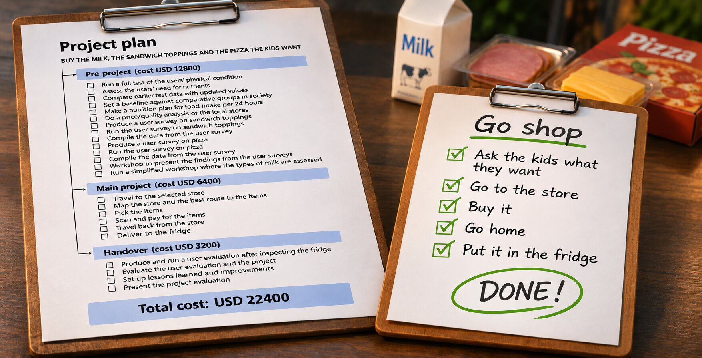

I am allergic to making things look harder than they are.

Corporations are full of overcomplications, trying to make stuff look harder or more arduous than they have to be.

I'm a simple guy. I can do simple. Let's play with this.

The kids want milk, sandwich toppings and pizza. Someone has to go to the store. Here is the project plan:

```
BUY THE MILK, THE SANDWICH TOPPINGS AND THE PIZZA THE KIDS WANT

Project plan
    Pre-project (cost USD 12,800)
        Run a full test of the users' physical condition
        Assess the users' need for nutrients
        Compare earlier test data with updated values
        Set a baseline against comparative groups in society
        Make a nutrition plan for food intake per 24 hours
        Do a price/quality analysis of the local stores
        Produce a user survey on sandwich toppings
        Run the user survey on sandwich toppings
        Compile the data from the user survey
        Produce a user survey on pizza
        Run the user survey on pizza
        Compile the data from the user survey
        Workshop to present the findings from the user surveys
        Run a simplified workshop where the types of milk are assessed and decided
    Main project (cost USD 6,400)
        Travel to the selected store
        Map the store and the best route to the items
        Pick the items
        Scan and pay for the items
        Travel back from the store
        Deliver to the fridge
    Handover (cost USD 3,200)
        Produce and run a user evaluation after inspecting the fridge
        Evaluate the user evaluation and the project
        Set up lessons learned and improvements
        Present the project evaluation
```

## Go shop

The whole project costs USD 22,400.

Let's buy that from KPMG.

## Or...

```
BUY THE MILK, THE SANDWICH TOPPINGS AND THE PIZZA THE KIDS WANT
    Ask the kids what they want
    Go to the store
    Buy it
    Go home
    Put it in the fridge
```

A big plan looks like serious work. It looks safe. Nobody gets blamed for running a survey first.

Or just fucking get it done.

## Summary

- [Scrum no more](/2026/09/Scrum-No-More.html): on process that gets in the way
- [Make it Simple](/2018/08/Simple.html): the OnePageBook
- [HyperList](https://isene.org/hyperlist/): the format of the plans above

---

Link to this post: https://isene.org/2026/11/Milk.html
