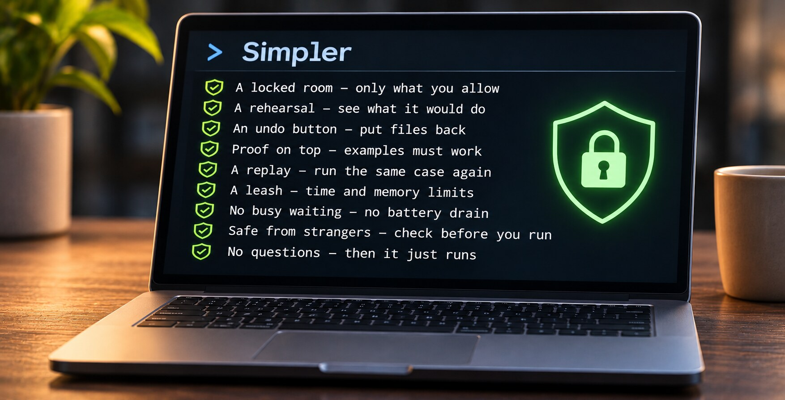
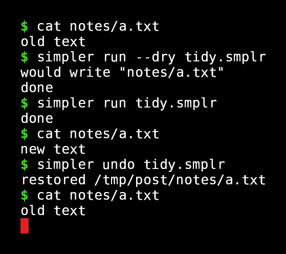
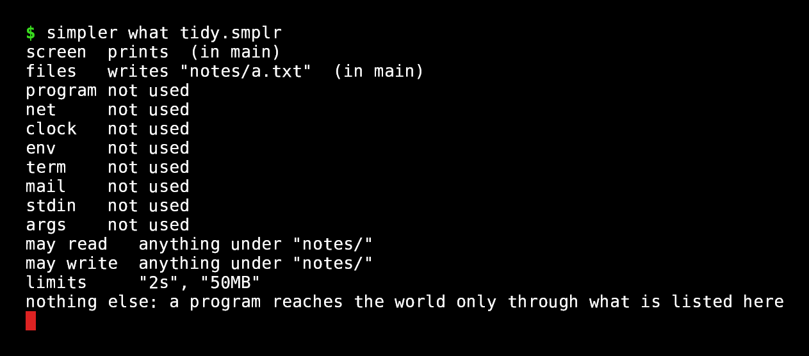
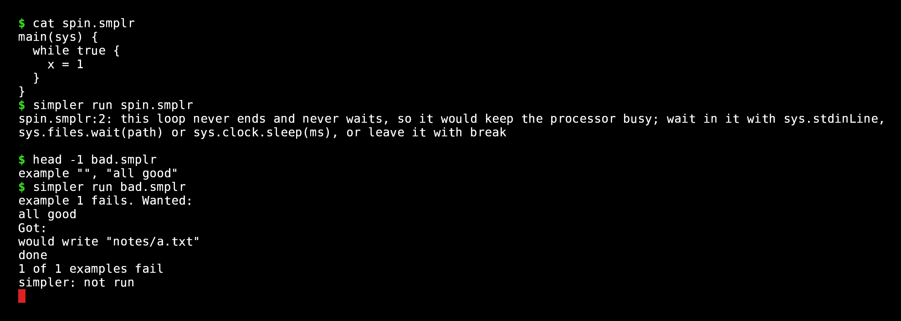

Trust is a major issue with using AI.

You let an AI write a program for you. You don't read it. You just run it.

What can go wrong? It can delete the wrong files. It can send your data somewhere. It can hang and eat your battery (OMG!).

[Simpler](https://github.com/isene/simpler) now has a safety net for all of that. Nine parts. Written up here, no tech degree needed:

**A locked room.** The program says up front what it may touch. Your computer itself then locks the door. This folder, that web site. The rest of your machine is out of reach, even if the program tries. It's real sandboxing.

**A rehearsal.** Run it once for show. It tells you what it would do: "would write this file", "would send this mail". Nothing happens for real.

**An undo button.** It changed your files and you regret it? One command, and the files are back as they were.

**Proof on top.** The first lines of the program are examples: this goes in, that must come out. If an example fails, the program will not run.

**A replay.** It failed at three in the night? It saved what it was given. Run that again in the morning and see the same failure.

**A leash.** One line says how long it may run and how much memory it may use. Past that, it is stopped.

**No busy waiting.** A program that spins in circles while it waits drains your battery (OMG again). Simpler refuses to build it.

**Safe from strangers.** Run a program straight from a link. First you see the list of what it may touch. Then you say yes or no.

**No questions.** When a program stays inside rules you wrote once, it runs. No "Allow?" box each time. This is how Claude Code should ideally function.

## How it looks

A small program that rewrites a note:

```
example "", "would write \"notes/a.txt\"\ndone"
limits "2s", "50MB"
reads "notes/"
writes "notes/"

main(sys) {
  sys.files.write("notes/a.txt", "new text\n")
  sys.screen.print("done")
}
```

The rehearsal, the real run and the undo:



What it can reach, without reading the code:



A program that spins, and one with a failing example. Neither gets to run:



## Simpler, Rust, Python

"Yourself" means you can get it, but you or your AI must write it or add a tool for it.

| | Simpler | Rust | Python |
|---|---|---|---|
| Says at the top what it may touch | Yes | No | No |
| The computer locks it to that list | Yes | Yourself | Yourself |
| One command lists all it can reach | Yes | No | No |
| Rehearsal run | Yes | Yourself | Yourself |
| Undo of file changes | Yes | Yourself | Yourself |
| Examples checked before every run | Yes | On request | On request |
| Replay of a failed run | Yes | Yourself | Yourself |
| Time and memory limit in one line | Yes | Yourself | Yourself |
| Refuses a loop that spins | Yes | No | No |
| Shows what a program from a link may touch | Yes | No | No |
| Time to start a small program | 1 ms | 1 ms | 22 ms |
| Ready-made libraries | 3 | Lots | Lots |
| The AI knows it from training | No | Yes | Yes |
| Big programs right on the first try | 22 of 30 | 25 of 30 | 26 of 30 |
| Right within three tries | 30 of 30 | 30 of 30 | 30 of 30 |

The last two rows: ten programs of 200 to 900 lines, written three times over by Claude Sonnet in each language (yeah, Sonnet).

Rust and Python win where you would expect. Claude has read millions of their programs and none of mine. It thinks longer when it writes Simpler.

The top ten rows are why I made it.

## Found by use

My style checker reads every answer Claude gives me. Its Simpler port ran under the new lock today. It printed the wrong hour.

The lock had closed the door to the time zone file. Every Simpler program that printed the time was one hour off. No test had seen it. A real program did. Fixed the same hour.

## Next

Simpler is in daily use on my laptop this week. Claude writes its helper scripts in it. What breaks gets fixed.

[Simpler](https://github.com/isene/simpler) is public domain. One line to install:

```
curl -fsSL https://raw.githubusercontent.com/isene/simpler/master/install.sh | sh
```

---

Link to this post: https://isene.org/2026/11/Net.html
