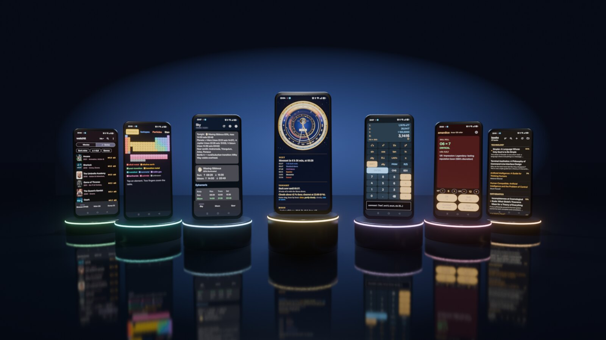

I tweak and improve and perfect stuff. On my laptop and on my phone.

In May I had completed seven apps on my phone, all made with Claude. Now I have more than twenty. Several of them replaced the apps that came with the phone: mail, notes, the browser, the file manager, the home screen launcher.

They all share one Rust core with my [Fe₂O₃](https://isene.org/fe2o3/) tools on the laptop. The data goes between phone and laptop over [Syncthing](https://syncthing.net). No Google account, no cloud, no app store. Free to download at [isene.org/nomad](https://isene.org/nomad/).

Welcome to the show room.

## The sky and the sciences

**orrery** is the newest. An astronomy clock, as ornate as I could make it. The dial is 24 hours with noon at the top. The ring of hours is the sky's colour through the day, twilights and all. The outer ring is the weather, hour by hour. Each planet draws its path and the zodiac turns with the sky. The Moon sits in a brass window, lit as it is tonight. All computed on the phone.

**astro** tells me when to pull out the telescopes and what to look at. It has the weather and the observing conditions, what is up tonight, the Moon with a named map, and my gear.

**science** is six subjects in one app. The periodic table, the isotopes, the particles of the Standard Model, the stars, the exoplanets... and every scale from the smallest to the whole universe.

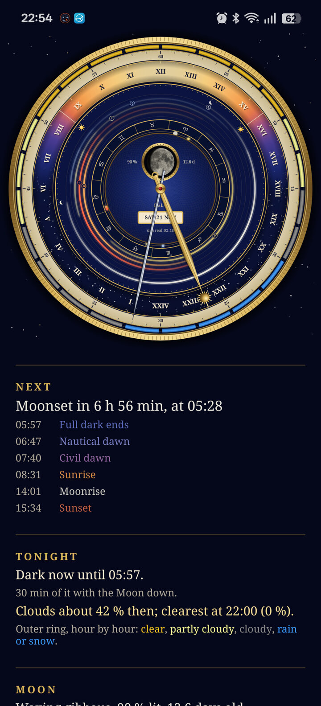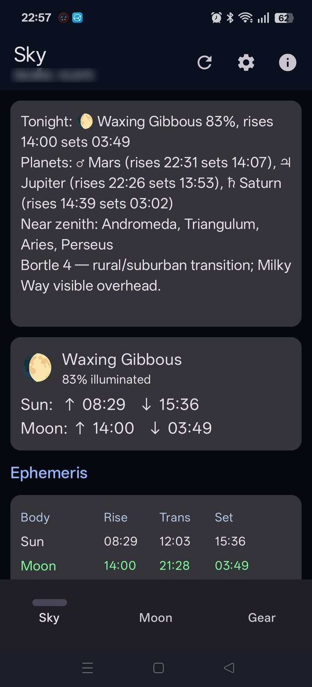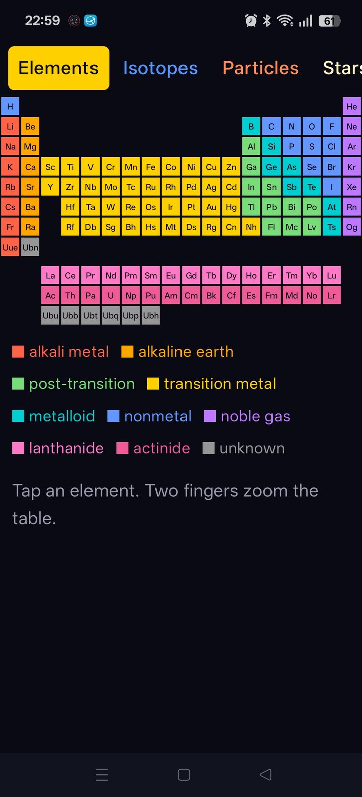

## Mail, notes and lists

**gluon** is mail, calendar and tasks in one app, like gluon on the laptop. It replaced Gmail.

**scribe** keeps my notes as plain text files in a folder shared with the laptop, with tags and pictures. It replaced Google Keep.

**hyperlist** edits [HyperLists](https://isene.org/hyperlist/), with colours, folding and drag to reorder.

**vox** starts recording the moment it opens. Say "remind me tomorrow at 12 to buy milk" and the task lands in my todo list, alarm and all.

**ref** is a reader for glossaries, books and writings. Searchable, offline.

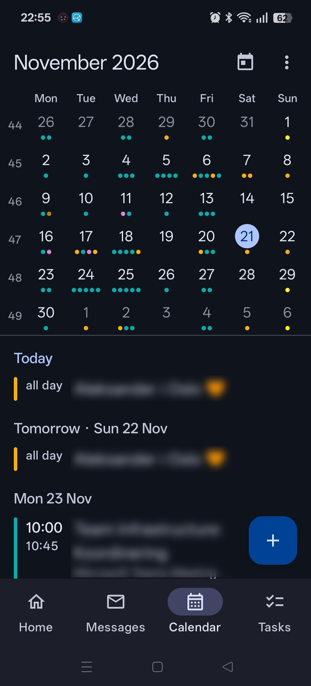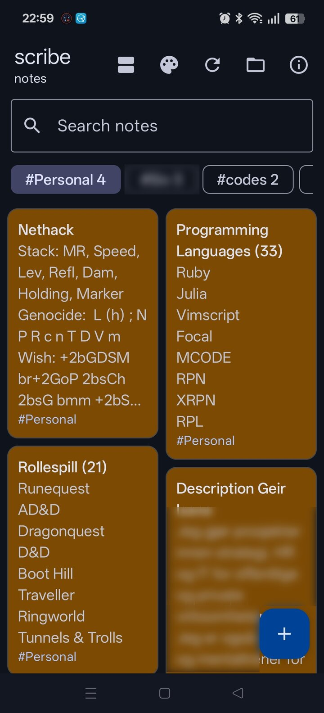

## Reading and watching

**books** is my library from the laptop, with figures and spoken chapters.

**gazette** reads my daily news digest, the last seven issues.

**watchit** browses films and series: top lists, posters and my wish list.

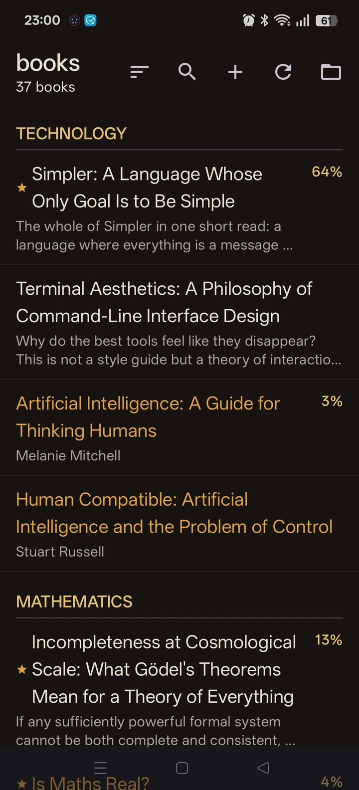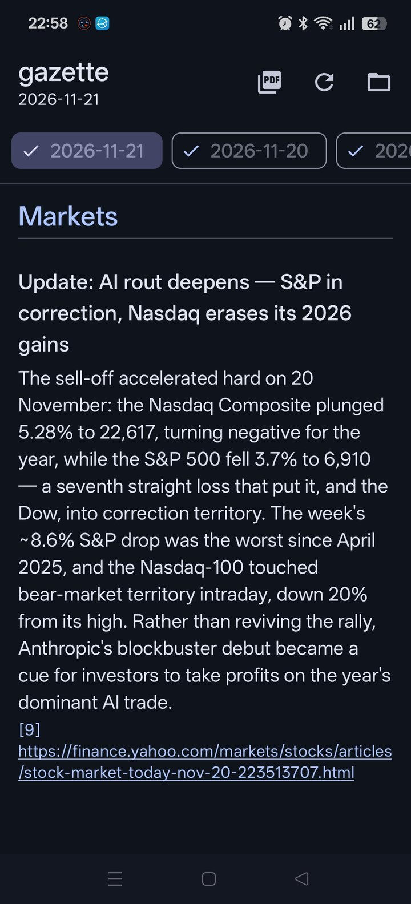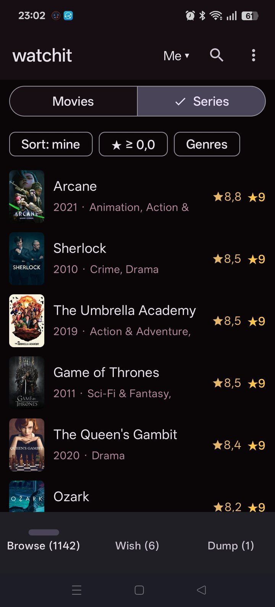

## The phone itself

**onepage** is my home screen. One page, widgets where I want them, and my apps in a panel on a swipe up. It uses no power while it waits.

**gaze** is my browser. It shares tabs, bookmarks and passwords with gaze on the laptop.

**pointer** is the file manager: a trash, undo for every step, and no network access at all.

**vault** has my passwords from the laptop's encrypted file. A tap copies one for 30 seconds.

**fresh** lists every app on the phone, newest first. **prism** picks colours and shows the contrast of a pair.

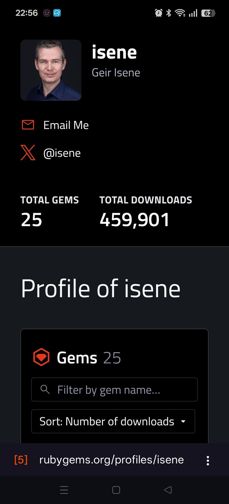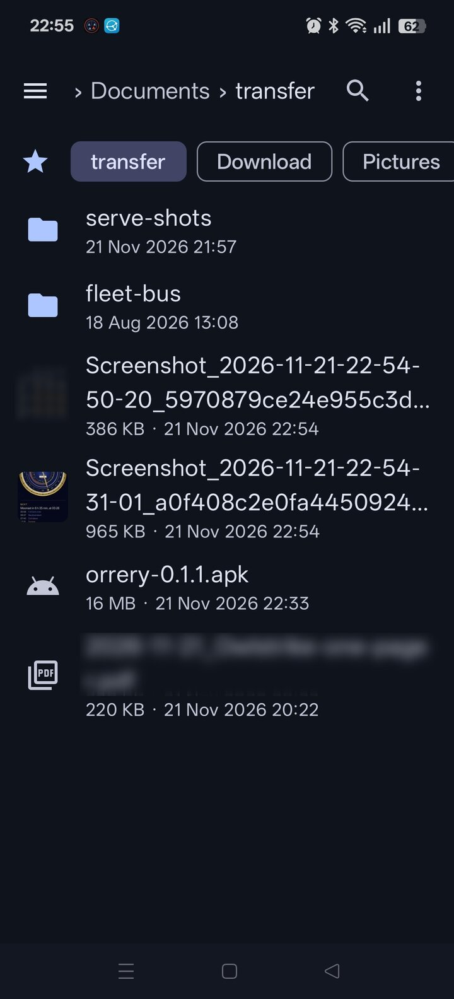

## The laptop at my side

**relay** sends my WhatsApp, Messenger, SMS and Discord messages to [kastrup](https://github.com/isene/kastrup) on the laptop, and my replies back.

**fleet** buzzes when a Claude Code session on the laptop is done, and lets me answer it from the phone.

## Play and numbers

**amardice** rolls the dice for my [Amar](https://d6gaming.org) role-playing game, crits and fumbles included.

**rpnx** is a pocket HP-41. It runs my old programs.

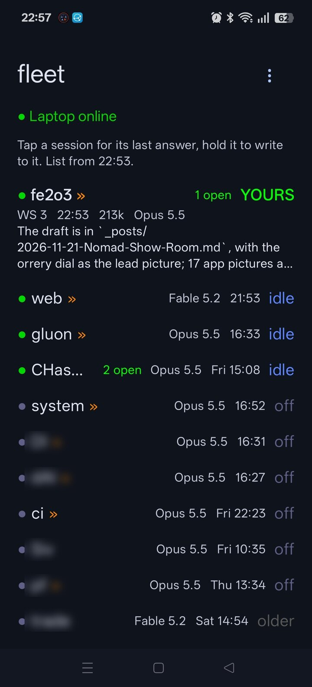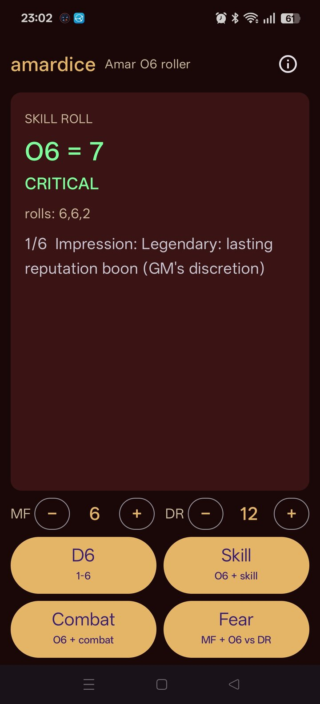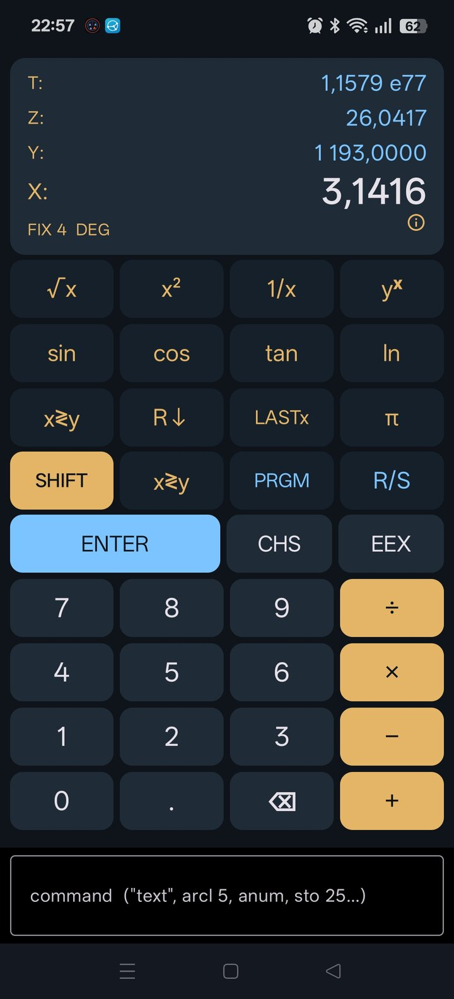

There are a few more apps I did as well...

Every app is at [isene.org/nomad](https://isene.org/nomad/). Android 13 or newer.

---

Link to this post: https://isene.org/2026/11/Nomad-Show-Room.html
