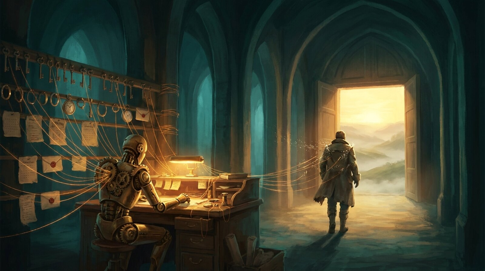

Stay amazing!

The reliable person looks like a machine. I'm not trying to insult anyone. It's a diagnosis.

## Binding

Play chess and you agree to a board of eight by eight and bishops that move diagonally. Nobody forces it on you. It arrives with your decision to play, and it binds you for as long as the decision remains.

A commitment is a [property](https://isene.com/freewill) you keep. A promise, a habit, a role, a taste, a position you once took and still defend. Each one narrows what you can do next. A shit-load of them, and your day runs itself. It makes no difference whether the commitment is yours alone or one you share with millions. Adding properties adds properties.

And properties bind while they're kept. Keeping is [the will's own act](https://isene.com/freewill/TheGroundMustChoose.pdf), every moment. That is why shedding or letting go works.

We score our leaders on laws added. Not much kudos is given for laws repealed.

## A die is unreliable too

So the reliable man is the machine-like man. Does the unreliable man go free?

No. A die is unreliable, and it has no freedom at all. Unreliability alone is noise. Shedding commitments is necessary for more freedom, but never enough. A fresh choice has to follow. Or you only rocked the boat.

## Forget, but on purpose

When I say forget, I mean "let go", never "lose track". A hidden commitment keeps running, like an app you swiped away that still eats the battery. A forgotten one that you let go is *gone*. RAM is restored.

Between the two you find the wise move: seeing the commitment. Once you see that you are keeping a choice, you can stop keeping it, and it dissolves without anything being crushed. What a collapse does by force, recognition does by sight.

## Every creation binds its maker

Each work is a new set of properties, and its maker keeps them. Paint the masterpiece and you are now the man who painted it. The only way on is to shed that too.

Bowie [retired Ziggy Stardust on stage](https://en.wikipedia.org/wiki/Ziggy_Stardust_and_the_Spiders_from_Mars:_The_Motion_Picture) in 1973, at the height of it. Two of the band didn't know. He had to kill the thing everyone loved, or play it forever.

## Florence and Japan

Renaissance Florence and modern Japan shed commitments in different ways.

Florence ran on guilds, workshops and patron contracts. Tight commitments. But it ran open contests too, like the one for the [Baptistery doors](https://en.wikipedia.org/wiki/Florence_Baptistery) in 1401. And it swapped old commitments for new ones: to Rome, to Greece. The swap was the engine.

Japan builds agreement first. [Nemawashi](https://en.wikipedia.org/wiki/Nemawashi): digging around a tree's roots before it is moved. A shared rule takes hold slowly, and thoroughly. The machine-like ideal is pursued openly, and reliability is the pride. Yet Japan's own arts know the way out: [shuhari](https://en.wikipedia.org/wiki/Shuhari). Keep the form. Break the form. Leave the form.

## Let the machine be the machine

AI is a commitment-keeper by construction. A computation [runs on procedure and odds](https://isene.com/freewill/TheGroundMustChoose.pdf), and nothing else. That is exactly the reliable side of the equation.

So people will automate with AI wherever they seek reliability. And rightfully so.

Let the machine keep what needs keeping. It may be incredibly advanced. But it is a tool.

The moral for you, then? Stay amazing: let go, then choose wisely.

---

Link to this post: https://isene.org/2026/11/Reliable.html
