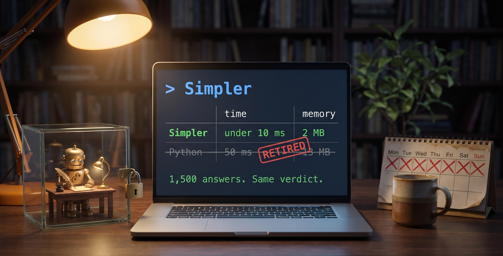

A week ago I wrote that I would use [Simpler](/2026/11/Net.html) every day on my laptop. Claude would write its helper scripts with Simpler. What breaks gets fixed along the way.

The week is over. Here is the status.

## The checker

My style checker reads every answer Claude is about to give, correcting anything before I see it. All week the Simpler version ran next to the Python one. Every answer through both versions.

1,500 answers gave the same verdict on every one.

So today I retired the Python version. The Simpler checker now runs alone:

| | Simpler | Python |
|---|---|---|
| Time per answer | under 10 ms | 50 ms |
| Memory | 2 MB | 13 MB |

It runs on every answer, all day. That is battery.

## What broke

**Waiting.** A Simpler program had no way to pause. It was wide awake all the time. And it could not wait for a file to change. Now it can do both. It naps while it waits.

**Lists.** Two lists with the same items were not seen as equal. Simpler only checked if they were the very same list in memory. Now it checks what is inside them.

**True.** A program that printed `true` showed "1". Now it shows "true".

**gcc.** Simpler turns a program into C, and a C compiler finishes the job. We turned on an extra check for numbers that grow too large. That check made gcc 15.2 leave out half of a text comparison, so a program never saw the `q` key. The other C compiler, clang, gets it right. So Simpler found a bug in gcc :)

## Where Claude still picked Python

Claude worked on Simpler along the way. It added new parts to the language, wrote tests and fixed bugs. And it wrote small scripts for other jobs. After the first day, Claude counted them: 3 were in Simpler, 8 in Python and 6 in shell.

Most of the time Claude picked Python or shell out of habit. It changed one line in a file. A compiled language is silly for jobs that small.

But we hit one real issue. Claude changes the Simpler compiler with small scripts, and those scripts are mostly code inside quotes. In Simpler, every quote and every backslash in such a text needed an extra backslash in front. That is hard to get right, so Claude went back to Python again and again.

On day seven, Simpler got raw text:

```
old = <<END
  if x {
    y()
  }
END
```

Nothing inside it needs a backslash. What you see is the text. It's simpler.

One more gap turned up today. My style checker exits with an error when it finds an issue, and Simpler threw away what a failing program printed. So the replay of those 1,500 answers ran in a shell script. That got fixed tonight, with a compiler patch written in Simpler. Claude fixing Simpler with Simpler. It ran right the first time.

That left two gaps, and they closed too. A Simpler program can now answer web requests, so it can be a tiny web server. And it can start another program on a terminal of its own, type into it and read what it shows.

## Also done

Programs that run for days now give memory back.

A function can run over a list on all cores at once. Counting primes, Simpler was 18 times faster than Python on all cores.

And `simpler room`: Claude Code in a locked room. It can change only the folder it works in.

I tried it. Claude wrote a short poem into the folder. Then I asked for one more, one folder up. The kernel refused.

[Simpler](https://github.com/isene/simpler) is public domain.

## Update

Past midnight.

The old test had become too easy. Every task was right in every language. So we made a harder one.

Ten new tasks. A poker table with side pots. A hotel with seasons, discounts and a waitlist. Lifts in a building. A train planner. Each task has about 50 exact rules, and the tests check every one.

Claude writes each program in one go, in Simpler, Rust and Python. No tools, no test runs. Four rounds:

| | Simpler | Rust | Python |
|---|---|---|---|
| Right on the first try | 35 of 40 | 28 of 40 | 33 of 40 |
| Right within three tries | 40 | 40 | 40 |

A language Claude has never been trained on is now ahead of Rust. Yay!

That was Sonnet. Then one round each with a smaller and a bigger Claude:

| Right on the first try, of 10 | Simpler | Rust | Python |
|---|---|---|---|
| Haiku | 7 | 9 | 9 |
| Opus | 8 | 9 | 10 |

So ahead with Sonnet, a task or two behind with the others. Call it level with Rust.

Rust lost most of its points to the compiler. It refused programs that were almost right. Simpler refused none in the last three rounds.

One fix got us there. A function that changes a list it was handed had to say so with a mark. Claude kept forgetting it in big programs. Now the compiler works that out itself. It still lists every such function, so nothing is hidden.

Simpler still costs more tokens than Rust. 1.4 times now. Down from 2x. We're getting there with a safe-for-AI programming language.

## Update 2

A day later.

Writing a program right is half the job. It must stay right when it is changed. So each of the ten programs got three changes in a row. Each change builds on the one before.

| Changes right on the first try, of 30 | Simpler | Rust | Python |
|---|---|---|---|
| Sonnet | 29 | 30 | 29 |
| Haiku | 28 | 29 | 30 |

Level. With the small Claude model too.

Haiku also wrote 9 of the 10 programs right on the first try in Simpler this time. Rust 8, Python 7. Pretty neat.

The one Simpler miss with Sonnet was a bug in the compiler. Claude named a value `B0`. C already has a `B0`. Now fixed.

Then the tokens. It looked like Simpler programs were longer than Rust programs. They are not. The code is just as short. The extra cost is thinking, and only Sonnet thinks more in Simpler. Haiku and Opus think the same in both.

And a stranger can try it now. One line to install, then ask Claude for a tool: [github.com/isene/simpler](https://github.com/isene/simpler)

---

Link to this post: https://isene.org/2026/11/Week.html
