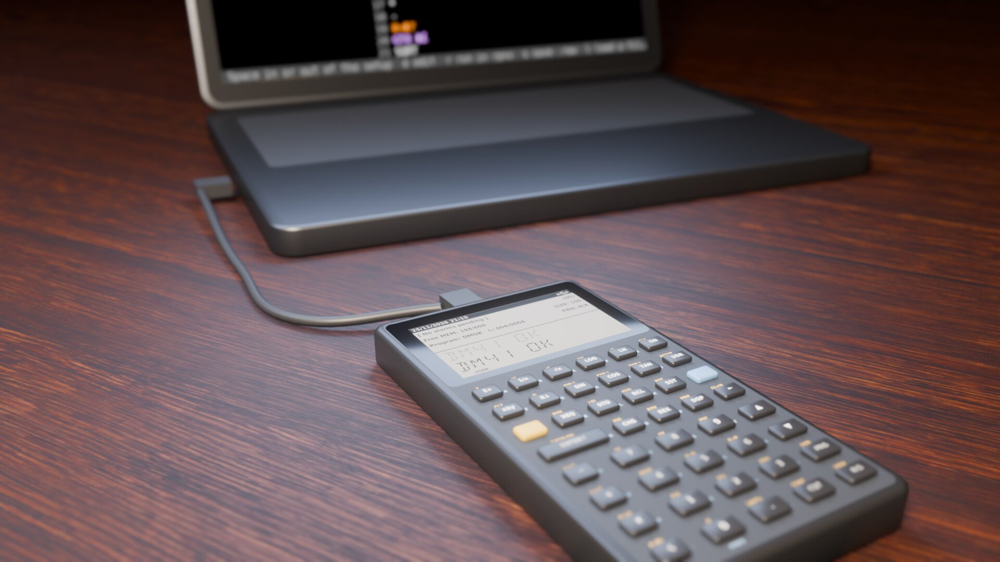
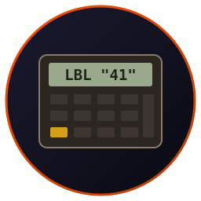
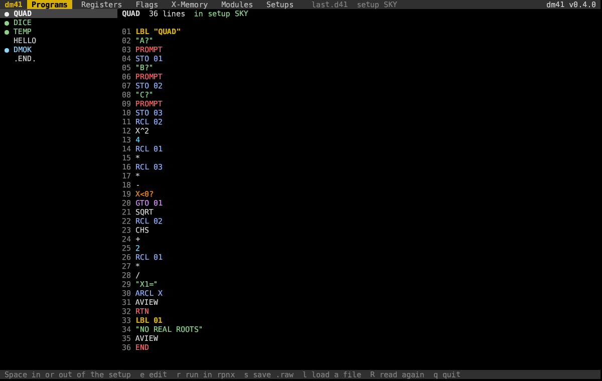
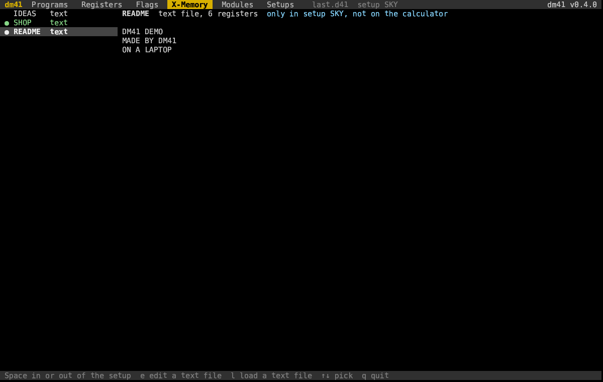
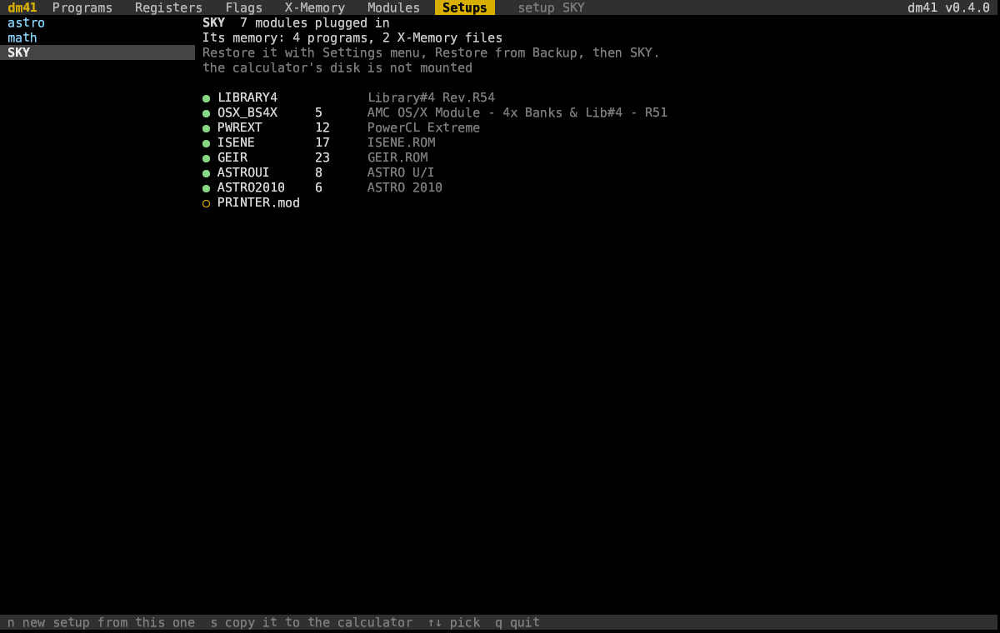
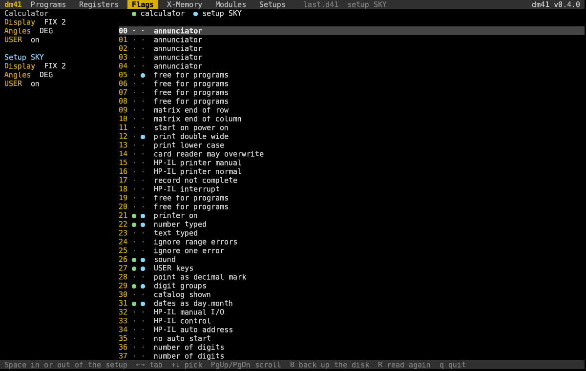

Back in 2020 when I was deep into the [SwissMicros DM41X](https://www.swissmicros.com/products/dm41x) (a modern well built HP-41 clone), [I wrote](https://isene.org/2020/03/DM41X.html) that I was missing a way to better interface with this little marvel. Today I got the urge to do just that... to move this up a notch.

I did sell my whole calculator collection this summer, but I still have this as a precious toy. Well, a bit more than a toy.

[dm41](https://github.com/isene/dm41) reads my DM41X. Plug the calculator in, pick File, Activate USB Disk, and the dm41 program shows what is inside: programs, registers, flags and X-Memory files.

Program listings come in colour. `e` opens a program in scribe, `r` runs it in rpnx, and `s` saves it as a .raw file. It's like X-Mas came early this year.

## Setups

A setup is a whole calculator: modules, programs, text files and flags. `n` starts a new setup. `Space` puts a program or a file in it, and `l` loads one from my laptop. dm41 writes the setup to the calculator as a full backup. Restore from Backup on the calculator brings it all in at once.

`B` (for "Backup") copies the calculator's whole disk to the laptop.

dm41 joined the [Fe₂O₃](https://isene.org/fe2o3/) family. Welcome to the Brady bunch, dm41!

(The image up there was made in [Blender](https://www.blender.org/)).

---

Link to this post: https://isene.org/2026/11/DM41.html
