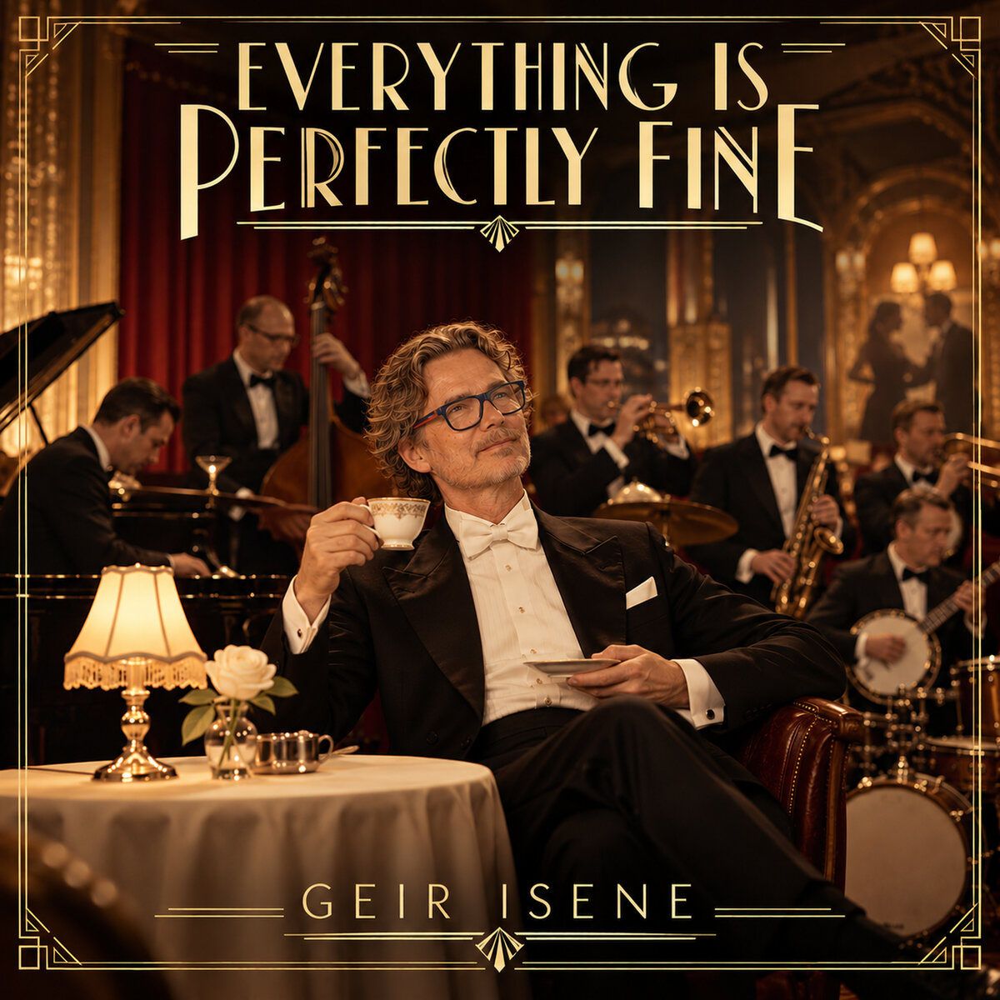

In more than three decades of coaching people, one thing stands out: There is a tendency to take things a lot more serious than they really are. The skill of letting go, to not give a fuck should be practiced regularily. Or else life tends to become quite stressful.

Everything Is Perfectly Fine is out on [Spotify](https://distrokid.com/hyperfollow/geirisene/everything-is-perfectly-fine) today. A jazz song with vocals, 3:20... the world ends, the wine runs out, the banker wants the house, and the band still plays. After all, it's just [Existence](https://isene.com/freewill).

## Listen

<audio src="/assets/music/perfectly-fine.mp3" controls preload="metadata" style="width:100%"></audio>

## Lyrics

The papers say the world is ending,\
The waiter says we're out of wine.\
My banker sends his warmest greetings,\
And asks me for the house by nine.

The rain comes through my bedroom ceiling,\
My automobile has disappeared,\
But darling, there's no cause for worry...\
I've had this feeling every year.

Everything is perfectly fine,\
The moon is bright, the debt is mine.\
The band still plays, the candles shine,\
So everything is perfectly fine.

You lost your heart, I lost my hat,\
We won't discuss the rest of that.\
Just light up the fireplace at nine...\
And everything is perfectly fine.

My neighbor left without a warning,\
He took my coat, but left his wife.\
She says she'll give it back on Tuesday...\
The coat, I mean. Such modern life.

The maître d' is looking nervous,\
The orchestra has missed the train,\
But someone found a little trumpet,\
So we shall start the night again.

Everything is perfectly fine,\
Your hand in hers, your foot on mine.\
The room may tilt from time to time,\
But everything is perfectly fine.

The rent is due, the clock is slow,\
And where we're going, no one knows.\
Just smile as though it's by design...\
And everything is perfectly fine.

A little disaster gives life sophistication.\
A little confusion improves conversation.\
And if tomorrow never comes—\
Well… that saves us making reservations.

Everything is perfectly fine,\
The stars are yours, the bill is mine.\
We'll dance until they cut the line,\
For everything is perfectly fine.

So straighten up your crooked tie,\
Don't ask me when, don't ask me why.\
The world can end at half past nine...\
But until then…\
Everything is perfectly fine.

---

Link to this post: https://isene.org/2026/11/Perfectly-Fine.html
