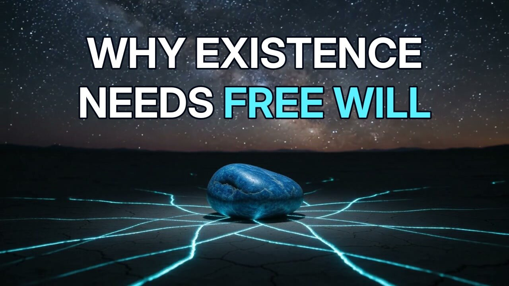

Why existence needs free will is out on YouTube. Two minutes with the points as simple and succinct as I can make them (for now). The pictures and the voice are AI. The argument is mine, simplified after countless iterations over the past 20 years.



## Links

- [TEG](https://isene.com/freewill): the argument in text, with the video on top
- [The first paper](https://philpapers.org/rec/ISETSG): on PhilPapers
- [Proof by machine](/2026/11/Proof-by-machine.html): TEG checked by the Lean proof assistant

---

Link to this post: https://isene.org/2026/11/Existence.html
