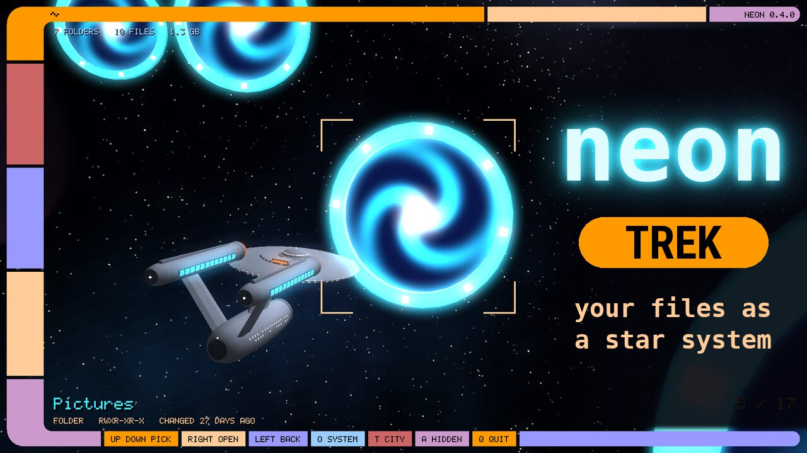

I used vifm and ranger for years. In 2020 I made my own file manager, [RTFM](https://github.com/isene/RTFM). Its successor, [pointer](https://github.com/isene/pointer), saw daylight this year. Now *pointer* has a 3D mode.



## The city

[neon](https://github.com/isene/neon) shows a folder as a city at night. Each file is a tower, as tall as the file size. Each folder is a glowing gate, and it takes you through a tunnel of light. The towers near you show a preview of the file content: a picture shows itself, a text file previews the first lines.

## Trek

Press `t`, and the folder becomes a star system, framed like the Star Trek LCARS screens of my desktop [face lift](/2026/10/Face-Lift.html). A file is a planet, a folder is a jump portal, and the Enterprise flies from one to the next. The file content shows on the viewscreen.

`Ctrl+W` in pointer opens neon on the folder you are in. Quit, and pointer is where you went. When the camera stops, neon sleeps until the next key. You know, [battery](/2026/11/Still.html).

neon runs on [funkey](https://isene.org/funkey/), my game engine for the terminal, and it joined the [Fe₂O₃](https://isene.org/fe2o3/) family.

The music is "Solitude" from my album [Rise Above](/2026/10/Rise-Above.html). The folders in the film are made up.

---

Link to this post: https://isene.org/2026/11/neon.html
